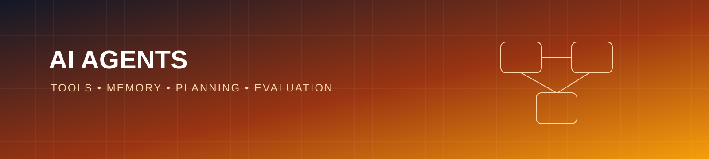

# AI Agents Workbench

Educational AI agent projects exploring tools, memory, planning, and evaluation with a focus on simple, inspectable Python code.

## What is an AI agent?

An agent observes a task, chooses an action, uses available tools, and evaluates the result. This repository treats agents as regular software: explicit state, bounded steps, logs, tests, and human oversight.

## Design principles

- Keep tool permissions narrow and explicit
- Limit iterations, time, and external requests
- Log decisions without storing secrets
- Validate tool inputs and outputs
- Require human approval for consequential actions

## Roadmap

- [ ] Add a deterministic calculator tool
- [ ] Add a bounded task loop
- [ ] Add short-term memory with a clear schema
- [ ] Add tool-call tests and failure simulation
- [ ] Compare agent behavior with a small evaluation set

## Safety note

Never give an agent unrestricted access to accounts, credentials, personal data, or irreversible operations.

## License

MIT License. See [LICENSE](LICENSE).
